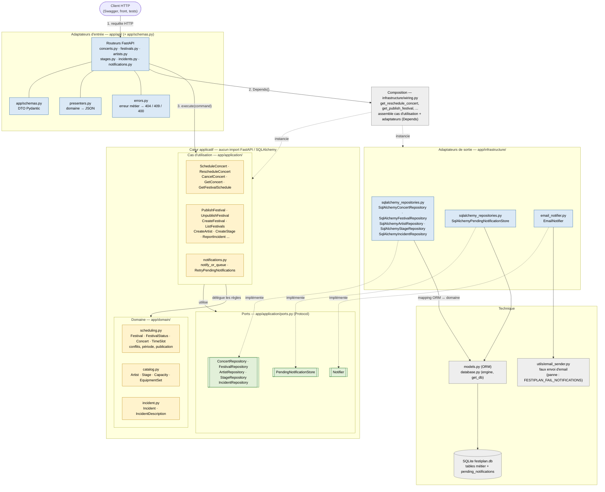
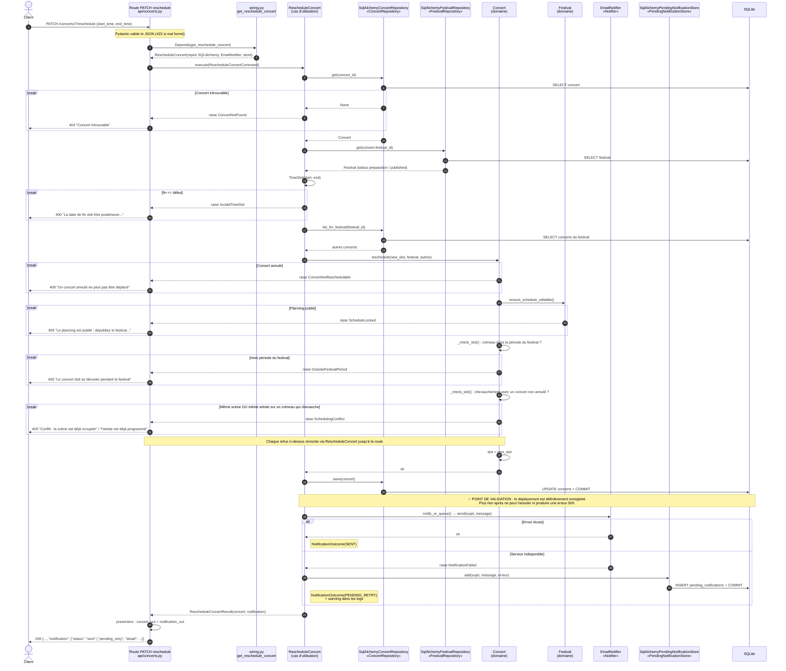

# Diagrammes d'architecture

## 1. Diagramme de composants

**Légende :** jaune = cœur (domaine + cas d'utilisation), vert = ports, bleu = adaptateurs, gris = technique.
Flèche pleine = dépendance (« utilise »). Flèche pointillée = « implémente » (de l'adaptateur vers le port qu'il réalise)
ou « instancie » (depuis la racine de composition). Toutes les flèches entre le cœur et les adaptateurs pointent vers le cœur.
Les cinq dépôts sont regroupés dans un seul bloc pour garder le diagramme lisible ; le tableau ci-dessous détaille chaque port.

### Lecture du diagramme

**Où sont le domaine et les cas d'utilisation ?**
Dans `app/domain/` et `app/application/`. Ces modules n'importent ni FastAPI, ni SQLAlchemy, ni la configuration.
Toutes les dépendances vont vers le cœur, jamais dans l'autre sens.

**Ports et adaptateurs qui les implémentent :**

| Port (`app/application/ports.py`) | Adaptateur (`app/infrastructure/`) | Technologie |
|---|---|---|
| `ConcertRepository` | `SqlAlchemyConcertRepository` | SQLAlchemy / SQLite |
| `FestivalRepository` | `SqlAlchemyFestivalRepository` | SQLAlchemy / SQLite |
| `ArtistRepository` | `SqlAlchemyArtistRepository` | SQLAlchemy / SQLite |
| `StageRepository` | `SqlAlchemyStageRepository` | SQLAlchemy / SQLite |
| `IncidentRepository` | `SqlAlchemyIncidentRepository` | SQLAlchemy / SQLite |
| `PendingNotificationStore` | `SqlAlchemyPendingNotificationStore` | table `pending_notifications` |
| `Notifier` | `EmailNotifier` | `utils/email_sender.py` (faux email) |

Dans les tests unitaires (`tests/test_reschedule_use_case.py`, `tests/test_schedule_use_case.py`), ces ports
sont remplacés par des faux en mémoire. C'est ce qui montre que le cœur est vraiment découplé.

**Comment une requête HTTP atteint le cœur :**
1. Le routeur FastAPI reçoit la requête, et Pydantic (`schemas.py`) valide le JSON.
2. `Depends(get_...)` demande à `wiring.py` un cas d'utilisation déjà assemblé avec ses adaptateurs.
3. Le routeur construit une commande (ex. `RescheduleConcertCommand`) et appelle `execute()`.
4. Le résultat est traduit en JSON par `presenters.py`. Les exceptions métier sont traduites en code HTTP par `errors.py`.

**Persistance et notifications :**
`wiring.py` est le seul endroit qui connaît à la fois les cas d'utilisation et les classes concrètes : il instancie les adaptateurs et les injecte dans les cas d'utilisation.
La persistance passe par les dépôts SQLAlchemy, qui convertissent les lignes ORM (`models.py`) en objets du domaine.
Les notifications passent par `EmailNotifier`. En cas d'échec, elles sont stockées dans `pending_notifications`
via `PendingNotificationStore`, puis renvoyées par `RetryPendingNotifications` (`POST /notifications/retry`).

**Écarts assumés :**
- Les routeurs importent `wiring.py`, qui se trouve dans `infrastructure/`. C'est la racine de composition :
  elle doit connaître tout le monde, et ce lien reste limité aux fonctions `get_...` passées à `Depends`.
- `ConcertNotFound` et `FestivalNotFound` sont définies dans leurs modules de cas d'utilisation, puis regroupées dans `application/errors.py`.

## 2. Diagramme de séquence — Déplacer un concert

`PATCH /concerts/{concert_id}/reschedule` avec `{"start_time": ..., "end_time": ...}`.

### Points clés

- **Ordre des vérifications :** introuvable → créneau valide → concert annulé → planning publié → période du festival → conflits.
  Au premier refus, l'exception remonte jusqu'à la route en traversant `RescheduleConcert` (qui ne l'intercepte pas),
  puis la route la traduit avec `errors.py`. Pour garder le diagramme lisible, les flèches de refus vont directement à la route.
  Aucune écriture n'a eu lieu, donc la base est inchangée.
- **Où vivent les règles :** les vérifications métier sont dans `Concert.reschedule()` et `Festival.ensure_schedule_editable()`.
  Le cas d'utilisation se contente d'orchestrer : charger, déléguer au domaine, sauvegarder, notifier.
- **Moment de validation :** le `COMMIT` dans `SqlAlchemyConcertRepository.save()`. La notification est envoyée
  après, de façon synchrone. Il n'y a pas de mécanisme asynchrone.
- **Échec de la notification :** il ne transforme pas la réponse en erreur. La réponse est `200` avec
  `"status": "pending_retry"`, et la notification est conservée en base pour être renvoyée.