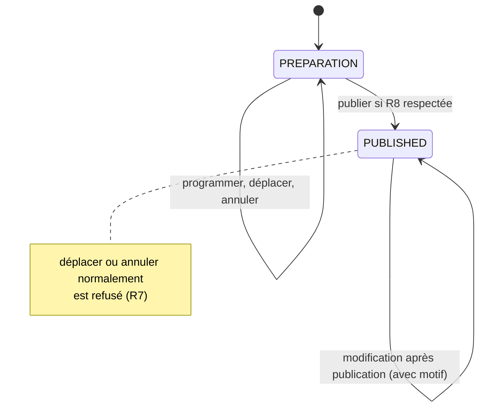

# Modélisation du domaine

## 1. Schéma du domaine

```mermaid
classDiagram
    direction LR

    namespace Agregat_Festival {
        class Festival {
            <<racine>>
            id
            name
            location
            period : FestivalPeriod
            status : FestivalStatus
            concerts : List~Concert~
        }
        class Concert {
            <<entité>>
            id
            artist_id
            stage_id
            slot : TimeSlot
            status : ConcertStatus
        }
    }

    namespace Agregat_Stage {
        class Stage {
            <<racine>>
            id
            festival_id
            name
            capacity : Capacity
            available_equipment : EquipmentSet
        }
    }

    namespace Agregat_Artist {
        class Artist {
            <<racine>>
            id
            name
            genre
            required_equipment : EquipmentSet
        }
    }

    namespace Agregat_Incident {
        class Incident {
            <<racine>>
            id
            concert_id
            description : IncidentDescription
            occurred_at
            resolved
        }
    }

    namespace Objets_valeurs {
        class TimeSlot {
            <<objet-valeur>>
            start
            end
        }
        class FestivalPeriod {
            <<objet-valeur>>
            start
            end
        }
        class EquipmentSet {
            <<objet-valeur>>
            items
        }
        class Capacity {
            <<objet-valeur>>
            value
        }
        class IncidentDescription {
            <<objet-valeur>>
            text
        }
        class FestivalStatus {
            <<enumeration>>
            PREPARATION
            PUBLISHED
        }
        class ConcertStatus {
            <<enumeration>>
            SCHEDULED
            CANCELLED
        }
    }

    Festival "1" *-- "0..*" Concert
    Festival *-- FestivalPeriod
    Festival *-- FestivalStatus
    Concert *-- TimeSlot
    Concert *-- ConcertStatus
    Concert ..> Artist : artist_id
    Concert ..> Stage : stage_id
    Stage ..> Festival : festival_id
    Stage *-- Capacity
    Stage *-- EquipmentSet
    Artist *-- EquipmentSet
    Incident ..> Concert : concert_id
    Incident *-- IncidentDescription
```

- Trait plein avec losange : l'objet fait partie de l'agrégat.
- Pointillés : un agrégat en référence un autre seulement par son identifiant.
- Chaque bloc `Agregat_...` correspond à une frontière d'agrégat.

## 2. Entités

| Entité | Pourquoi c'est une entité |
|---|---|
| `Festival` | Son planning et son statut changent, mais c'est toujours le même festival. |
| `Concert` | Deux concerts peuvent avoir le même créneau sans être le même concert. Un concert déplacé reste le même concert. |
| `Stage` | Une scène reste la même même si sa capacité ou ses équipements changent. |
| `Artist` | Un artiste peut avoir plusieurs concerts, il doit donc être identifiable. |
| `Incident` | Chaque incident doit pouvoir être retrouvé et suivi (champ `resolved`). |

## 3. Objets-valeurs

Les objets-valeurs sont immuables et vérifient leurs règles à leur création. Si les valeurs sont invalides, l'objet ne peut pas être créé.

| Objet-valeur | Contenu | Règle vérifiée à la création |
|---|---|---|
| `TimeSlot` | début, fin | R1 : la fin est strictement après le début |
| `FestivalPeriod` | début, fin | la fin est après le début |
| `EquipmentSet` | liste de noms d'équipements | pas de nom vide |
| `Capacity` | entier | R9 : strictement positive |
| `IncidentDescription` | texte | R10 : non vide |

Dans le code initial, les équipements sont stockés comme une chaîne séparée par des virgules (`"large_rigging,special_lighting"`). `EquipmentSet` remplace cette chaîne par un ensemble, ce qui permet de vérifier R5 avec une simple comparaison : les équipements requis par l'artiste doivent être inclus dans ceux de la scène.

`TimeSlot` sert aussi à savoir si deux créneaux se chevauchent. La règle n'est donc écrite qu'à un seul endroit, alors qu'aujourd'hui la comparaison des dates est faite à la fois dans la route de déplacement et dans `SchedulingService`.

## 4. Agrégats

### Festival (racine) avec ses concerts

C'est l'agrégat principal. Les règles R2, R3, R6, R7 et R8 ont toutes besoin de connaître l'ensemble des concerts du festival :

- pour vérifier qu'un créneau est libre sur une scène (R2) ou pour un artiste (R3), il faut voir les autres concerts ;
- pour vérifier qu'un concert est dans les dates du festival (R6), il faut la période du festival ;
- la publication (R7, R8) concerne tout le planning.

Les concerts font donc partie de l'agrégat `Festival`, et on ne peut créer, déplacer ou annuler un concert qu'en passant par le festival. C'est ce qui corrige le défaut 1 : aujourd'hui, `reschedule_concert` modifie directement le concert sans refaire les contrôles de la création. Avec ce modèle, le déplacement passe forcément par les mêmes vérifications.

Le planning n'est pas une classe à part : c'est la liste des concerts du festival et son statut.

### Stage

Une scène appartient à un festival (`festival_id`), mais sa capacité et ses équipements peuvent changer sans toucher aux concerts. Elle forme donc son propre agrégat.

### Artist

Un artiste ne dépend d'aucun festival et peut être programmé dans plusieurs. Il forme son propre agrégat.

### Incident

Un incident est lié à un concert par son identifiant, mais il est séparé de l'agrégat `Festival` : déclarer un incident ne modifie pas le planning, et ça doit rester possible quand le planning est publié.

### Pourquoi pas d'autres découpages

- **Un agrégat `Concert` séparé** : un concert seul ne connaît pas les autres concerts, il ne peut donc pas vérifier R2 et R3. Les contrôles se retrouveraient de nouveau dans les services.
- **Tout dans `Festival`** : les artistes n'appartiennent pas à un festival, et les incidents ne doivent pas dépendre du statut du planning. L'agrégat serait plus gros sans protéger plus de règles.

## 5. Où sont protégées les règles

| Règle | Où | Comment |
|---|---|---|
| R1 | `TimeSlot` | Refus à la création du créneau |
| R2 | Agrégat `Festival` | Vérification des chevauchements sur la même scène lors d'une programmation ou d'un déplacement (concerts annulés ignorés) |
| R3 | Agrégat `Festival` | Même vérification pour l'artiste, toutes scènes confondues |
| R4 | Cas d'utilisation + `Festival` | Le cas d'utilisation vérifie que le festival, l'artiste et la scène existent. Le festival vérifie que la scène lui appartient |
| R5 | Agrégat `Festival` | Les équipements requis de l'artiste doivent être inclus dans ceux de la scène |
| R6 | Agrégat `Festival` | Le créneau doit être compris dans `FestivalPeriod` |
| R7 | Agrégat `Festival` | Déplacement et annulation ordinaires refusés si le statut est `PUBLISHED` |
| R8 | Agrégat `Festival` | Avant de passer à `PUBLISHED`, le festival revérifie R2, R3, R5 et R6 sur tous les concerts programmés |
| R9 | `Capacity` | Refus à la création |
| R10 | Cas d'utilisation + `IncidentDescription` | Le cas d'utilisation vérifie que le concert existe. La description vide est refusée à la création |

Le domaine vérifie tout ce qui ne dépend que des données qu'il a. Le cas d'utilisation vérifie seulement ce qui demande d'aller chercher des données (l'existence d'un festival, d'une scène, d'un artiste ou d'un concert). Pydantic reste utilisé pour le format des requêtes HTTP, mais aucune règle métier ne repose uniquement dessus, contrairement au code initial où la capacité et la description d'incident ne sont vérifiées que par les schémas.

## 6. Statut du planning (défaut 3)

Dans le code initial, le statut du planning est le champ `status` du festival (`preparation` ou `published`). On garde ce fonctionnement avec l'énumération `FestivalStatus`.

Règle retenue :

- quand le planning est publié, un déplacement ordinaire est refusé avec une erreur métier ;
- une opération spécifique, « modification après publication », permet de corriger le planning. Elle demande un motif, refait toutes les vérifications et produit un événement pour prévenir le public.

## 7. Événements de domaine

Un événement décrit quelque chose qui s'est déjà passé. Le festival l'enregistre pendant l'opération, et le cas d'utilisation le transmet après l'enregistrement en base, par exemple pour envoyer une notification.

| Commande | Cas d'utilisation | Événement | Réaction |
|---|---|---|---|
| Programmer un concert | `ScheduleConcert` | `ConcertScheduled` | — |
| Déplacer un concert | `RescheduleConcert` | `ConcertRescheduled` | Notification |
| Annuler un concert | `CancelConcert` | `ConcertCancelled` | Notification |
| Publier le planning | `PublishSchedule` | `SchedulePublished` | Notification |
| Modifier après publication | `AmendPublishedSchedule` | `PublishedScheduleAmended` | Notification au public |
| Déclarer un incident | `ReportIncident` | `IncidentReported` | — |

Lien avec le défaut 2 : la notification est envoyée après l'enregistrement, en réaction à l'événement. Si l'envoi échoue, la modification reste valide et l'API ne doit pas répondre par une erreur 500. Le traitement exact de cet échec sera mis en place à l'étape 5.
