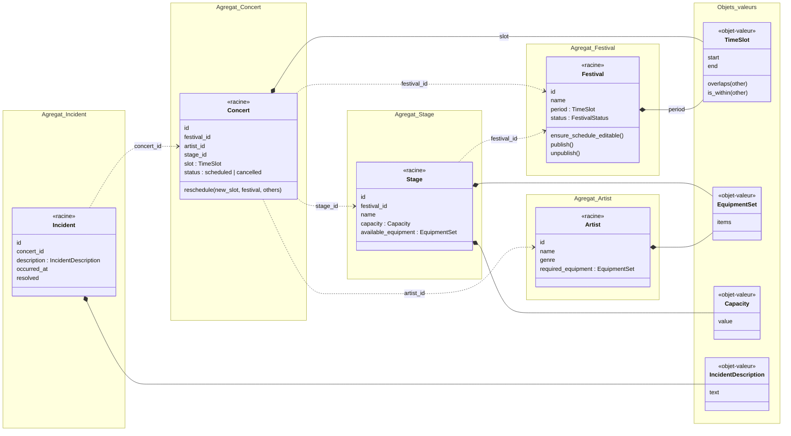
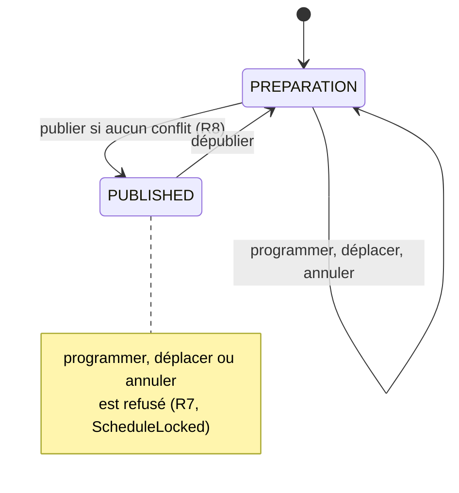

# Modélisation du domaine

## 1. Schéma du domaine

- Trait plein avec losange : l'objet fait partie de l'agrégat.
- Pointillés : un agrégat en référence un autre seulement par son identifiant.
- Chaque bloc `Agregat_...` correspond à une frontière d'agrégat.

## 2. Entités

| Entité | Pourquoi c'est une entité |
|---|---|
| `Festival` | Son statut change, mais c'est toujours le même festival. |
| `Concert` | Deux concerts peuvent avoir le même créneau sans être le même concert. Un concert déplacé reste le même concert. |
| `Stage` | Une scène reste la même même si sa capacité ou ses équipements changent. |
| `Artist` | Un artiste peut avoir plusieurs concerts, il doit donc être identifiable. |
| `Incident` | Chaque incident doit pouvoir être retrouvé et suivi (champ `resolved`). |

Le statut du festival est une énumération, `FestivalStatus` (`PREPARATION` ou `PUBLISHED`), car il a un cycle de vie avec des transitions contrôlées (voir section 6). Le statut du concert reste une valeur simple : `scheduled` ou `cancelled`.

## 3. Objets-valeurs

Les objets-valeurs sont immuables et vérifient leurs règles à leur création. Si les valeurs sont invalides, l'objet ne peut pas être créé.

| Objet-valeur | Contenu | Règle vérifiée à la création |
|---|---|---|
| `TimeSlot` | début, fin | R1 : la fin est strictement après le début |
| `EquipmentSet` | liste de noms d'équipements | pas de nom vide |
| `Capacity` | entier | R9 : strictement positive |
| `IncidentDescription` | texte | R10 : non vide |

`TimeSlot` sert à la fois pour le créneau d'un concert et pour la période d'un festival. Il porte deux comportements :

- `overlaps()` : deux créneaux se chevauchent-ils ? (R2, R3) ;
- `is_within()` : un créneau est-il compris dans un autre ? (R6, avec la période du festival).

La règle de chevauchement n'est donc écrite qu'à un seul endroit, alors que dans le code initial la comparaison des dates est faite à la fois dans la route de déplacement et dans `SchedulingService`.

Dans le code initial, les équipements sont stockés comme une chaîne séparée par des virgules (`"large_rigging,special_lighting"`). `EquipmentSet` remplace cette chaîne par un ensemble, ce qui permet de vérifier R5 avec une simple comparaison : les équipements requis par l'artiste doivent être inclus dans ceux de la scène.

## 4. Agrégats

### Concert

Le concert est l'agrégat qui porte les règles de programmation. Pour changer de créneau, on passe par `concert.reschedule(new_slot, festival, others)`, qui reçoit :

- le **festival**, en lecture seule, pour connaître sa période (R6) et son statut (R7) ;
- la liste des **autres concerts du festival**, pour détecter les chevauchements de scène (R2) et d'artiste (R3).

Toutes les vérifications du déplacement sont ainsi au même endroit, dans le domaine. C'est ce qui corrige le défaut 1 : dans le code initial, `reschedule_concert` modifiait le concert sans refaire les contrôles de la création.

Le planning n'est pas une classe à part : c'est la liste des concerts d'un festival.

### Festival

Le festival garde sa période et son statut. Il ne contient pas ses concerts : les concerts le référencent par `festival_id`.

C'est lui qui contrôle le cycle de vie du planning :

- `publish()` et `unpublish()` changent le statut, et refusent une transition impossible (publier un festival déjà publié, dépublier un festival en préparation) avec `InvalidFestivalTransition` ;
- `ensure_schedule_editable()` refuse toute modification du planning quand il est publié (`ScheduleLocked`). Le concert l'appelle avant un déplacement, et la création d'un concert aussi.

### Stage

Une scène appartient à un festival (`festival_id`), mais sa capacité et ses équipements peuvent changer sans toucher aux concerts. Elle forme donc son propre agrégat.

### Artist

Un artiste ne dépend d'aucun festival et peut être programmé dans plusieurs. Il forme son propre agrégat.

### Incident

Un incident est lié à un concert par son identifiant. Déclarer un incident ne modifie pas le planning, et ça doit rester possible quand le planning est publié.

### Choix retenu et compromis

On aurait pu faire du `Festival` la racine d'un agrégat qui contient tous ses concerts : toute modification passerait alors par le festival, qui connaît déjà tous les concerts. On a préféré garder le `Concert` comme agrégat :

- chaque concert est chargé et enregistré seul, comme dans la base existante, ce qui limite la refactorisation ;
- on évite de charger tout le festival pour modifier un seul concert.

Le compromis : le concert ne peut vérifier R2 et R3 que si le cas d'utilisation lui donne bien la liste complète des autres concerts du festival. Cette responsabilité est donc partagée entre le domaine (la règle) et le cas d'utilisation (le chargement des données).

### Pourquoi pas tout dans un seul agrégat

Les artistes n'appartiennent pas à un festival, et les incidents ne doivent pas dépendre du statut du planning. Un agrégat unique serait plus gros sans protéger plus de règles.

## 5. Où sont protégées les règles

| Règle | Où | Comment |
|---|---|---|
| R1 | `TimeSlot` | Refus à la création du créneau (`InvalidTimeSlot`) |
| R2 | `Concert` | Vérification des chevauchements sur la même scène avec les autres concerts (concerts annulés ignorés) → `SchedulingConflict` |
| R3 | `Concert` | Même vérification pour l'artiste, toutes scènes confondues → `SchedulingConflict` |
| R4 | Cas d'utilisation | Le cas d'utilisation vérifie que le festival, l'artiste, la scène ou le concert existent, et que la scène appartient au festival |
| R5 | `Concert` (programmation) | Les équipements requis de l'artiste doivent être inclus dans ceux de la scène |
| R6 | `Concert` | Le créneau doit être compris dans la période du festival → `OutsideFestivalPeriod` |
| R7 | `Festival` | `ensure_schedule_editable()` refuse de programmer, déplacer ou annuler un concert tant que le planning est publié → `ScheduleLocked` |
| R8 | Cas d'utilisation de publication | Avant d'appeler `festival.publish()`, vérification qu'aucun concert programmé n'est en conflit (scène ou artiste) |
| R9 | `Capacity` | Refus à la création |
| R10 | Cas d'utilisation + `IncidentDescription` | Le cas d'utilisation vérifie que le concert existe. La description vide est refusée à la création |

Un concert annulé ne peut pas être déplacé (`ConcertNotReschedulable`).

Le domaine vérifie tout ce qui ne dépend que des données qu'il reçoit. Le cas d'utilisation vérifie ce qui demande d'aller chercher des données (l'existence d'un objet) et fournit au domaine ce dont il a besoin (le festival, les autres concerts). Pydantic reste utilisé pour le format des requêtes HTTP, mais aucune règle métier ne repose uniquement dessus, contrairement au code initial où la capacité et la description d'incident ne sont vérifiées que par les schémas.

Les erreurs métier ne connaissent pas HTTP : c'est la route qui les traduit en codes (409 pour un conflit ou un planning publié, 400 pour une donnée invalide, 404 si l'objet n'existe pas).

## 6. Statut du planning (défaut 3)

Le statut du planning est le statut du festival (`FestivalStatus`).

Règle retenue : un planning publié ne peut pas être modifié directement. Toute tentative est refusée avec `ScheduleLocked` (409), et le message invite à dépublier le festival.

Pour corriger un planning publié, la procédure explicite est :

1. dépublier le festival (`POST /festivals/{id}/unpublish`) ;
2. faire les modifications, avec toutes les vérifications habituelles ;
3. republier, ce qui revérifie l'ensemble du planning (R8).

Pourquoi ce choix : il évite de bloquer définitivement un festival en cas d'imprévu, sans ajouter de règle de modification particulière, puisque les modifications passent par les opérations ordinaires.

Ses limites :

- pendant la correction, le planning n'est plus publié ;
- on ne garde pas de trace de la raison de la dépublication. Une évolution possible serait une modification exceptionnelle avec un motif obligatoire, sans dépublier.

## 7. Événements de domaine

Un événement décrit quelque chose qui s'est déjà passé, et peut déclencher un mécanisme technique comme une notification.

| Commande | Cas d'utilisation | Événement | Réaction |
|---|---|---|---|
| Déplacer un concert | `RescheduleConcert` | Concert déplacé (`ConcertRescheduled`) | Notification |
| Programmer un concert | `ScheduleConcert` | Concert programmé | — |
| Annuler un concert | `CancelConcert` | Concert annulé | Notification |
| Publier le planning | `PublishFestival` | Planning publié | Notification |
| Dépublier le planning | `UnpublishFestival` | Planning dépublié | — |
| Déclarer un incident | `ReportIncident` | Incident déclaré | — |

On n'a pas créé de classes d'événements : pour rester simple, le cas d'utilisation appelle directement le port `Notifier` une fois la modification enregistrée.

### Lien avec le défaut 2

La notification est un effet secondaire : elle est tentée après l'enregistrement, et son échec n'annule jamais l'opération métier. Si l'envoi échoue :

1. l'adaptateur lève `NotificationFailed` ;
2. le cas d'utilisation met la notification en attente, avec le port `PendingNotificationStore` (table `pending_notifications`) ;
3. l'API répond 200, car l'opération est bien enregistrée, et indique l'état de la notification : `sent` ou `pending_retry`.

Les notifications en attente peuvent être consultées (`GET /notifications/pending`) et renvoyées à la demande (`POST /notifications/retry`, cas d'utilisation `RetryPendingNotifications`). Le renvoi n'est pas automatique, pour éviter un traitement en arrière-plan.